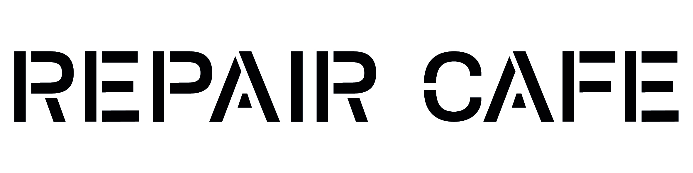

# A Repair Café Web App

## Description

---

## Features

* Volunteer registration and attendance
* Guest registration and attendance
* No web tracking or spying

---
## Requirements

### MySQL

MySQL 8.x or above

### PHP

PHP 8.2.35, 8.3.36, 8.4.27, 8.5.12, or above, because of the `php2shell` vulnerability that allows for unauthorized critical Remote Code Execution (RCE).

---

## Set Up

---

## Current Repair Cafés Using This App

---

## Links

[Start your own Repair Café](https://www.repaircafe.org/en/) | [Find a Repair Café near you](https://www.repaircafe.org/en/visit/) | [See a listing of Repair Cafés in NYC](https://www.repair-cafe.nyc/)
